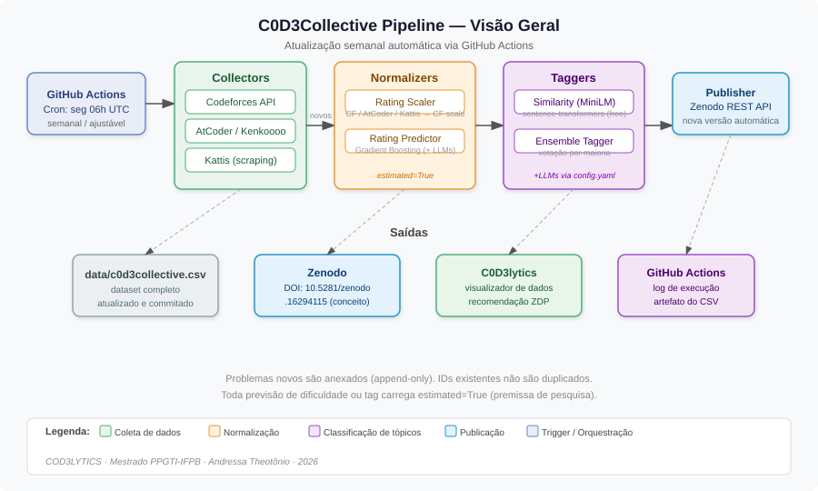
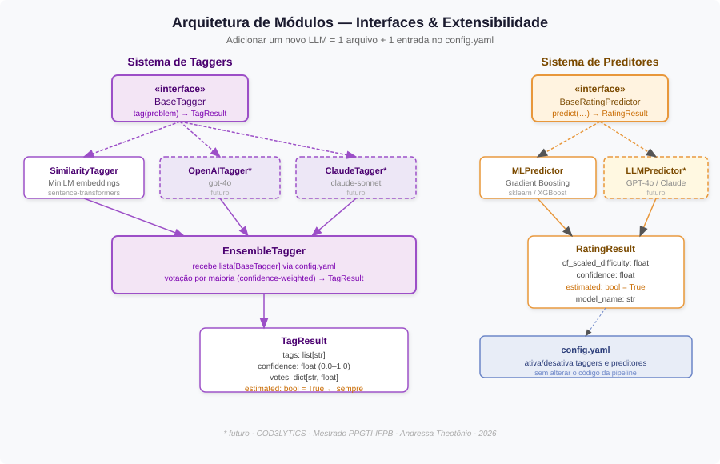

# c0d3collective-pipeline

Pipeline automático de atualização e enriquecimento do dataset **C0D3Collective**, parte da dissertação de mestrado [COD3LYTICS](https://c0d3-lytics.lovable.app) (PPGTI-IFPB).

> Dataset no Zenodo: **[DOI 10.5281/zenodo.16294115](https://doi.org/10.5281/zenodo.16294115)**

---

## O que esta pipeline faz

A cada semana (GitHub Actions, toda segunda-feira 06h UTC), a pipeline executa automaticamente:

1. **Coleta** — busca novos problemas via API pública do Codeforces, Kenkoooo (AtCoder) e scraping do Kattis
2. **Normaliza** — mapeia ratings nativos de cada plataforma para a escala Codeforces (800–3500) em `cf_scaled_difficulty`
3. **Prediz dificuldade** — para problemas sem rating nativo, estima com Gradient Boosting treinado no próprio dataset (`estimated=True`)
4. **Classifica tópicos** — para problemas sem tags, aplica similaridade semântica (sentence-transformers) e, futuramente, ensemble de LLMs votando independentemente
5. **Publica** — cria nova versão no Zenodo automaticamente via REST API

---

## Arquitetura

### Visão geral



### Módulos e interfaces



---

## Estrutura do repositório

```
c0d3collective-pipeline/
├── collectors/
│   ├── base.py              # BaseCollector + dataclass Problem
│   ├── codeforces.py        # API pública CF: problemset.problems
│   ├── atcoder.py           # Kenkoooo API (merged-problems + models)
│   └── kattis.py            # Scraping open.kattis.com
├── normalizers/
│   ├── rating_scaler.py     # CF / AtCoder / Kattis → escala CF
│   └── rating_predictor/
│       ├── base.py          # BaseRatingPredictor (interface plugin)
│       └── ml_predictor.py  # Gradient Boosting baseline (free)
├── taggers/
│   ├── base.py              # BaseTagger + TagResult (interface plugin)
│   ├── similarity_tagger.py # Similaridade semântica com MiniLM (free)
│   └── ensemble.py          # EnsembleTagger: votação ponderada por confiança
├── publishers/
│   └── zenodo.py            # Publica nova versão via Zenodo REST API
├── pipeline.py              # Orquestrador principal
├── config.yaml              # Habilita/desabilita módulos sem alterar código
├── pyproject.toml
└── .github/
    └── workflows/
        └── weekly_update.yml  # GitHub Actions: toda segunda 06h UTC
```

---

## Decisões de design

| Decisão | Escolha |
|---------|---------|
| Frequência de atualização | Semanal (ajustável em `weekly_update.yml`) |
| Problemas sem rating | Gradient Boosting → `estimated=True` (premissa de pesquisa) |
| Problemas sem tags | Similaridade semântica (MiniLM) + ensemble de LLMs (futuro) |
| Extensibilidade | Interface plugin: adicionar LLM = 1 arquivo + 1 entrada no `config.yaml` |
| Persistência de versões | Zenodo REST API: DOI conceito sempre aponta para a última versão |

---

## Como rodar localmente

### Requisitos

```bash
pip install -e ".[dev]"
```

### Executar pipeline completa

```bash
python pipeline.py --dry-run   # sem publicar no Zenodo
python pipeline.py             # coleta + normaliza + tagging + publica
```

### Treinar o modelo de predição de dificuldade

```bash
python pipeline.py --train --dry-run
```

### Apenas re-taguear problemas não classificados

```bash
python pipeline.py --tag-only --dry-run
```

---

## Adicionar um novo tagger (LLM)

1. Crie `taggers/meu_tagger.py` herdando `BaseTagger`:

```python
from taggers.base import BaseTagger, TagResult

class MeuTagger(BaseTagger):
    @property
    def tagger_name(self) -> str:
        return "meu_tagger"

    def tag(self, problem_id, problem_name, platform, existing_tags) -> TagResult:
        # chamar API do LLM aqui
        ...
```

2. Registre em `taggers/__init__.py` e adicione ao `config.yaml`:

```yaml
taggers:
  - name: similarity_minilm
  - name: meu_tagger
    api_key_env: MINHA_API_KEY
```

3. Adicione o `if name == "meu_tagger"` em `pipeline.py::build_taggers()`.

O `EnsembleTagger` passa a votar com todos os taggers ativos automaticamente.

---

## Secrets do GitHub Actions

| Secret | Descrição |
|--------|-----------|
| `ZENODO_TOKEN` | Token de acesso à API do Zenodo (Deposit > New Token) |

---

## Conexão com o mestrado

Este repositório é parte da dissertação **COD3LYTICS: Uma Ferramenta de Learning Analytics para Programação Competitiva** (Andressa Theotônio, PPGTI-IFPB, 2026).

O dataset enriquecido por esta pipeline alimenta o sistema de **recomendação adaptativa baseada em ZDP (Vygotsky, 1978)** integrado ao [C0D3lytics](https://c0d3-lytics.lovable.app).

---

*Gerado com [Claude Code](https://claude.com/claude-code)*
